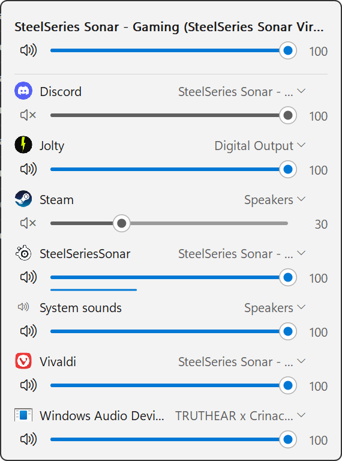

# Latchmix

A tiny Windows 11 tray volume mixer that **remembers your volume and mute settings and keeps them**.

<a href="https://ko-fi.com/joltarise"></a>

Set Spotify to 30%, mute Discord, mute your speakers: Latchmix puts them back whenever Windows, a game or the app itself changes them, after a restart, and when a device or app shows up again.

It is written in Rust against the Win32 and Core Audio APIs directly. No runtime, no framework, no polling.

<p align="center"></p>

## What it does

- **Left click** the tray icon: a flyout with the master volume and mute of the current output device, plus one slider and mute button per app that has an audio session, on any output device. A thin level bar under each slider shows the live output peak (60 dB scale). Mouse wheel over a row changes it in 2% steps.
- **Device button on each app row**: send that app to another output device, or back to "Default (follow Windows)". This is the same per-app setting as Windows' *Sound > Volume mixer*, so Windows remembers it and other tools see it.
- **Middle click** the tray icon: mute or unmute the current output device.
- **Right click** the tray icon: pick the default output device (the active one is checked). It sets the console, multimedia and communications roles.
- **Remembers what you set.** Moving a slider or pressing mute pins that value for the output volume or for that app. The output pin is shared by every output device, so switching outputs keeps the same volume. A small pin shows next to pinned rows. Right click a row and choose *Forget saved volume and mute* to unpin it.
- **Keeps it.** Any outside change to a pinned value is reverted immediately, including the Windows volume keys and apps that reset their own volume.
- **Re-applies on start and on arrival.** Pinned values are applied at launch and whenever the device or app appears again.
- **Keyboard**: arrows move between rows, left and right change the volume (2%, hold Shift for 10%), Space or M mutes, Enter opens the device menu of an app, Esc closes.
- Follows the system light/dark theme and accent color, per-monitor DPI, and a taskbar on any edge.
- Starting it again while it is running opens the flyout of the running copy.

Volume and mute are pinned independently: muting an app does not pin its volume, and the other way around. Apps are identified by executable name.

## Install

Download `latchmix.exe` from the [releases page](../../releases) (or build it, see below) and run it. There is no installer. The first time it runs it adds itself to *Start with Windows*; untick that in the tray menu if you do not want it. If you later move the exe, the next launch repoints the startup entry.

The exe is not code signed, so SmartScreen may ask for confirmation the first time.

## Build

Requirements: Windows 10 or 11, the Rust toolchain (stable, MSVC target) and the Visual Studio Build Tools with the C++ workload.

```
cargo build --release
cargo test
```

The result is a single ~320 KB executable. The file icon and version info are embedded with `rc.exe` from the Windows SDK; if the SDK is not installed the build still works, just without them.

## Where settings live

`%APPDATA%\latchmix\prefs.tsv`, one line per pinned item: `key<TAB>volume percent<TAB>mute`. A `-` means "not pinned". It is plain text and safe to edit while the app is closed. Nothing is sent anywhere.

## How it stays light

- Everything is event driven. Core Audio callbacks (endpoint volume, session volume and state, new sessions, device changes) only post a message to the main window, and bursts are coalesced into one. There are no timers and no polling while the flyout is closed. While it is open, one 33 ms timer reads the level meters and repaints only when a bar moved.
- The flyout is one window drawn with GDI into a memory bitmap. Shapes are anti-aliased by a small signed-distance rasteriser. The bitmap and fonts are freed when the flyout closes.
- A correction loop breaker pauses enforcement for 5 seconds if something keeps fighting a pinned value.

Measured on a Ryzen 5 3600 / Windows 11 (release build):

| | Latchmix | EarTrumpet 2.3 (same PC, same time) |
|---|---|---|
| Idle CPU over 20 to 30 s | 0 ms | 0 ms |
| Private memory, idle | 2.7 MB | 54 MB |
| Working set, idle | 15 MB (up to ~26 MB after using the flyout) | 88 MB |
| Threads / handles | 6 / 211 | 19 / 958 |
| Start until message loop is idle | about 55 ms | not measured |
| CPU with the flyout open and sound playing, 10 s | below the counter resolution (16 ms) | not measured |

Working set includes shared system DLL pages, so private memory is the fairer number.

## Not implemented

- Global hotkeys, input devices (microphones), translations.
- Scrolling when more apps are playing than fit on screen: extra apps are cut off.
- When several processes of one app have different volumes, the row shows the first one and a change applies to all of them.

## Limitations

- A pinned value always wins. If you pin the speaker volume, the keyboard volume keys will be reverted until you forget the pin.
- Devices that only support coarse volume steps are matched within 1.5%.
- The default device switch and the per-app device setting use undocumented Windows interfaces (`IPolicyConfig` and the `AudioPolicyConfig` factory, the same ones EarTrumpet uses). The factory layout used here is the one from Windows 10 21H2 and later; on anything else the device button is hidden. Windows applies a new per-app device to a running stream for some apps and from the next stream for others.

## License

Copyright (C) 2026 CyberKird. Latchmix is free software under the [GNU General Public License v3.0 or later](LICENSE): you can read, build, share and change it, and any modified version you distribute must stay open under the same license.

Thanks to [EarTrumpet](https://github.com/File-New-Project/EarTrumpet) for the idea and for documenting how the undocumented Windows audio interfaces are laid out. No code was taken from it.
